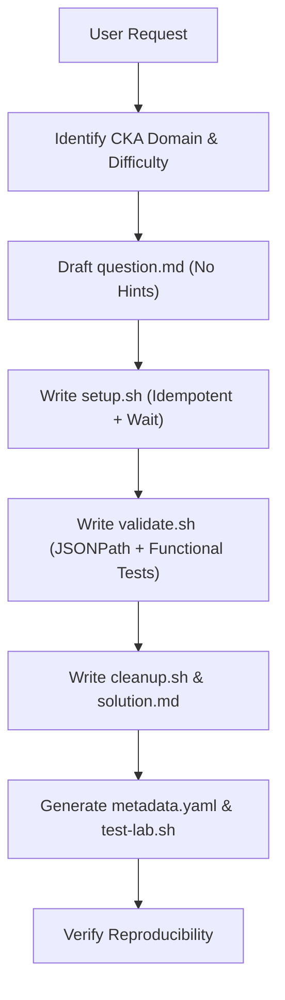

# CKA Lab Generator Skill

This skill provides the methodology, guidelines, and tools to generate practical Kubernetes labs tailored for the **CKA (Certified Kubernetes Administrator)** certification, runnable on any playground (Killercoda, Killer.sh, Kind, Minikube, K3s, or bare-metal Kubeadm clusters).

---

## 1. Required Components per Lab

Every generated lab must contain the following components:

```text
<lab-folder-name>/
├── metadata.yaml    # Classification, CKA exam weight, difficulty level, and estimated time
├── question.md      # Rigorous, exam-style technical problem statement (no hints or spoilers)
├── setup.sh         # Idempotent bash script preparing the initial state or injecting faults
├── validate.sh      # Bash script functionally and declaratively evaluating the solution (exit 0 / exit 1)
├── cleanup.sh       # Bash script to revert changes and leave the cluster clean
├── solution.md      # Step-by-step official solution guide with high-speed CKA imperative tricks
└── test-lab.sh      # Verification test harness for setup -> solution -> validate -> cleanup
```

### Why are these additional components necessary?
1. **`cleanup.sh`**: Enables immediate reuse of the playground without leaving orphaned objects or requiring cluster reboots.
2. **`solution.md`**: Keeps the solution separate from the prompt to avoid spoilers during student practice attempts.
3. **`metadata.yaml`**: Enables cataloging labs across official CKA domains and assembling timed mock exams.
4. **`test-lab.sh`**: Guarantees **reproducibility** and prevents regressions in CI environments or shared playgrounds.

See [Lab Architecture Specification](./references/lab-architecture-spec.md) for full details.

---

## 2. Strict Rules for Generating CKA Labs

### Rule 1: Problem Statement Format (`question.md`)
- **Linux Foundation Style**: Clear, concise, imperative, and technical.
- **No Hints**: Never include suggested commands, kubectl syntax hints, or solution shortcuts in `question.md`.
- **Explicit Parameters**:
  - Context (`kubectl config use-context ...` if applicable).
  - Exact resource names (`pod`, `service`, `deployment`, `pvc`, `networkpolicy`, `serviceaccount`).
  - Target namespace.
  - Ports, labels, selectors, and absolute file paths.

### Rule 2: Idempotence & Robustness in `setup.sh`
- Always include `set -euo pipefail`.
- Clean up beforehand with `kubectl delete ... --ignore-not-found=true` before creating resources to allow repeated execution.
- Use `kubectl wait --for=condition=Ready ... --timeout=60s` to ensure the environment is fully operational before handing control to the student.
- If the lab is a **Troubleshooting** task, programmatically inject the error (e.g., misconfigure kubelet, corrupt a static pod manifest, or break a service).

### Rule 3: Exhaustive Validation in `validate.sh`
- Always include `set -uo pipefail` (prevent commands from failing silently or aborting before evaluating all checks).
- Structured visual output with color indicators:
  - `[PASS]` for satisfied requirements.
  - `[FAIL]` with explicit details showing discrepancy between expected and actual values.
- **Unix Exit Codes**:
  - Return `exit 0` **only** if all tests pass.
  - Return `exit 1` if any requirement fails.
- **Two-Tier Verification**:
  1. *Declarative*: Query fields using `kubectl get ... -o jsonpath='{...}'` (avoid fragile regex on raw YAML output).
  2. *Functional*: Validate real connectivity (`curl`/`wget` with timeouts, `nslookup`), permissions with `kubectl auth can-i`, or disk mounts.
- See [Validation Patterns](./references/validation-patterns.md).

### Rule 4: Speed Optimization in `solution.md`
- Focused on **CKA exam speed**:
  - Prioritize imperative commands with `--dry-run=client -o yaml`.
  - Common shortcuts (`k`, `po`, `deploy`, `svc`, `netpol`, `pvc`, `sa`).
  - Concise explanations of the tested concepts and common pitfalls.

---

## 3. Workflow for Creating a Lab

When asked to generate a lab for a specific topic:



### Step 1: Initial Scaffold
Use the helper script to initialize the lab directory:
- Bash: `bash .agents/skills/cka-lab-generator/scripts/scaffold-lab.sh <lab-name> "<CKA Domain>"`
- PowerShell: `.\.agents\skills\cka-lab-generator\scripts\scaffold-lab.ps1 -LabName "<lab-name>" -Domain "<CKA Domain>"`

### Step 2: Component Customization
1. Adjust `metadata.yaml` with the official domain per [CKA Curriculum Matrix](./references/cka-curriculum-matrix.md).
2. Author `question.md` adhering strictly to official Linux Foundation format.
3. Configure base manifests and fault injections in `setup.sh`.
4. Implement checks in `validate.sh` ensuring zero false positives and zero false negatives.
5. Provide imperative commands and architectural context in `solution.md`.
6. Verify the entire lifecycle by executing `test-lab.sh`.

---

## 4. References & Examples

- [Lab Architecture Specification](./references/lab-architecture-spec.md)
- [Validation Patterns in Bash](./references/validation-patterns.md)
- [CKA Curriculum & Scenario Matrix](./references/cka-curriculum-matrix.md)
- [Full Sample Lab: NetworkPolicy](./examples/sample-network-policy/)
